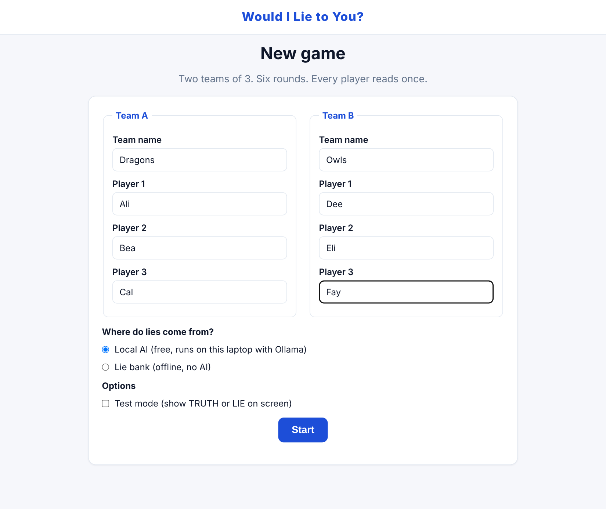
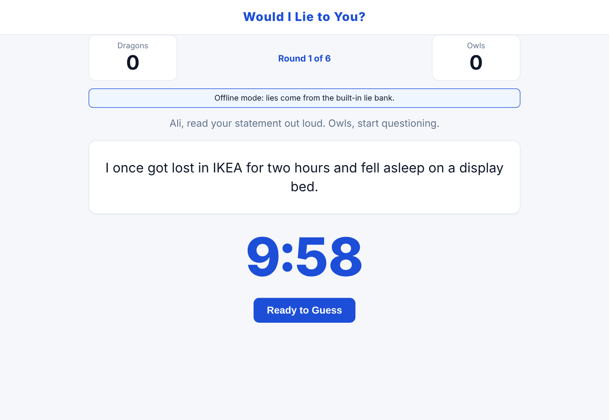
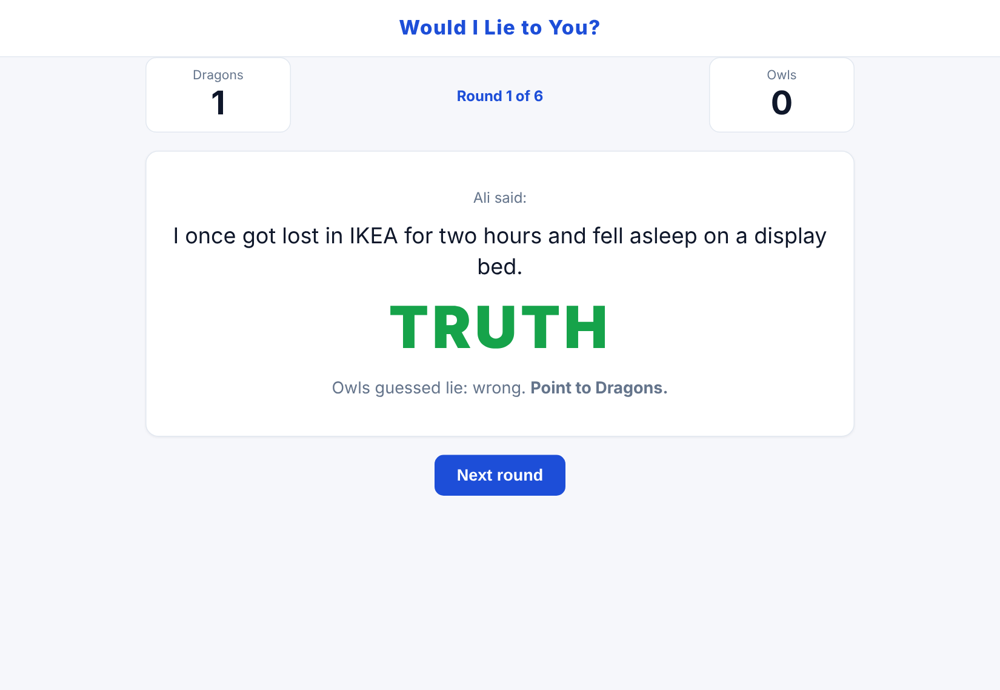

# Would I Lie to You? Web App

A browser version of the BBC panel show for two teams of three. Each round, a player reads out a statement about themselves. It is either one of their own true stories or a lie written by an AI running on the laptop, and the other team has 10 minutes to question them and decide which.

Built as a simulated client project during AI engineering work experience: requirements, change requests, testing and handover documents were produced alongside the code.



| Round in progress | Answer revealed |
| --- | --- |
|  |  |

## Features

- **3v3 game, 6 rounds**, every player speaks once, with **sudden death** if the scores are level
- **Private story entry:** each player writes 2 true stories with a "pass the laptop" privacy screen
- **AI-written lies** from a free model running locally in [Ollama](https://ollama.com), so nothing leaves the laptop and nothing costs money
- **Lie bank fallback:** 70 hand-written lies; if the AI isn't running, the game says so and carries on
- **No repeats:** the same lie never appears twice within 10 games (exact and near-duplicate checks)
- **Round flow:** reveal/hide statement, Spacebar to start, 10-minute timer, Ready to Guess, confirm, reveal
- **Scoring:** correct guess = point to the guessing team; wrong guess = point to the speaker's team
- **Test mode:** shows TRUTH or LIE on screen for demos and checking

## How the AI part works

1. Before round 1, `lie_provider.py` asks the local model for a batch of lies in one call, so no one waits mid-game.
2. The prompt (`wilty/ai_prompt.py`) includes the players' true stories as a style guide, 5 hand-written example lies as a quality bar, rules against anything implausible or offensive, and recently used lies to avoid.
3. Every lie returned is checked for offensive words and for exact or near-duplicates of recent lies (`difflib` similarity), and rejected ones are regenerated.
4. If Ollama isn't running, the model isn't downloaded, or the reply is unusable, the game falls back to the lie bank.

**What I learned from prompt engineering:** the first prompt produced lies like "my pet goldfish can solve complex maths problems", which no one would believe. Adding real example lies and banning superpowers, lottery wins and fame made the output far more believable, for example "my brother's pet chicken escaped and we had to chase it round the neighbourhood".

## Run it (Mac)

```bash
python3 -m venv .venv
source .venv/bin/activate
pip install -r requirements.txt
python app.py
```

Open http://127.0.0.1:5050 and choose where lies come from:

| Option | Needs | Cost |
| --- | --- | --- |
| Local AI (default) | Ollama running on the Mac | Free |
| Lie bank | Nothing | Free |

### Local AI setup

1. Install Ollama from https://ollama.com and open it (it runs in the menu bar).
2. `ollama pull llama3.2:3b` (about 2 GB).
3. Start the game and pick **Local AI**.

On an 8 GB Mac use the smaller model: `ollama pull llama3.2:1b`, then `cp .env.example .env` and set `WILTY_OLLAMA_MODEL=llama3.2:1b`.

## Tests

```bash
pytest
```

37 automated tests (game rules, scoring, sudden death, lie bank, no-repeat rules, every page route) use a fake AI, so they run in seconds without Ollama. A manual test run of 25 checks on a MacBook also passed, including a full game with the local AI (lies ready in about 10 seconds); see [Test results](docs/WILTY%20(TEST%20RESULTS).pdf).

For quick manual testing, tick **Test mode** and shorten the timer: `WILTY_TIMER_SECONDS=5 python app.py`

## Project structure

```
app.py                 Flask routes and session (M8)
config.py              Settings from environment variables (M1)
wilty/
  models.py            Data classes (M2)
  game_engine.py       Game rules: turn order, scoring, sudden death (M3)
  ai_prompt.py         Prompt and checks for AI lies (M4)
  local_client.py      Talks to Ollama (M4b)
  lie_bank.py          Built-in lies (M5)
  lie_history.py       No-repeat tracking (M6)
  lie_provider.py      Chooses the lie source and filters duplicates (M7)
templates/, static/    Pages, styles and game.js (timer, Spacebar, reveal) (M9)
tests/                 pytest suite with a fake AI (M10)
data/lie_bank.json     70 hand-written lies
docs/                  Project documents and screenshots
```

Game logic and lie handling are plain Python with no Flask or network code, which is what makes them quick to unit test.

## Project documents

The project was run like a client engagement, with Graham Fry acting as the client.

| Document | What it covers |
| --- | --- |
| [Business requirements (BRD)](docs/WILTY%20(BRD).pdf) | Scope, game rules, 24 functional and 8 non-functional requirements |
| [Project plan](docs/WILTY%20(PROJECT%20PLAN).pdf) | Timeline, client check-ins, client testing, change control, risks |
| [Module breakdown](docs/WILTY%20(MODULE%20BREAKDOWN).pdf) | Architecture diagram, modules and build order |
| [Test requirements](docs/WILTY%20(TEST%20REQUIREMENTS).pdf) | 37 test cases mapped to requirements |
| [Test results](docs/WILTY%20(TEST%20RESULTS).pdf) | Automated and manual test results |
| [Change request 01](docs/WILTY%20(CHANGE%20REQUEST%2001).pdf) | Add a free local AI option |
| [Change request 02](docs/WILTY%20(CHANGE%20REQUEST%2002).pdf) | Remove the paid Claude API |
| [Client testing pack](docs/WILTY%20(UAT%20PACK).pdf) | Setup, test scenarios and feedback form for the client |
| [User guide](docs/WILTY%20(USER%20GUIDE).pdf) | How to play |

Word versions of each are in `docs/` too.

## Tech stack

Python 3, Flask, Ollama (Llama 3.2), vanilla JavaScript, pytest.

## How it was built

Built with AI-assisted coding (Claude) during AI engineering work experience. I wrote the requirements and made the design and scope decisions, and everything was checked with automated tests and manual test runs.

## Author

Abdul-Haque Mohammed · [GitHub](https://github.com/abdulhaquemohammed) · [LinkedIn](https://www.linkedin.com/in/abdulhaquemohammed)
